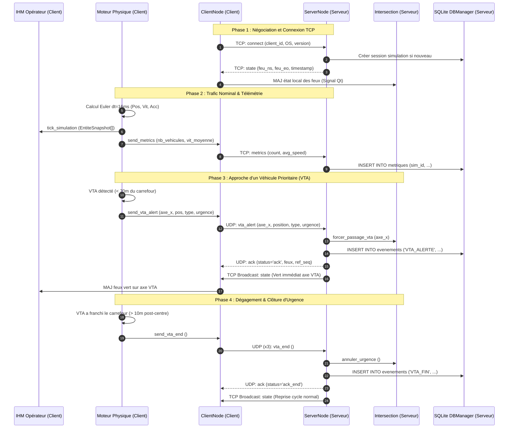

# Documentation Technique de Référence — Projet Esk-2718
## Simulation 2D de Régulation Intelligente de Carrefours & Communications V2X/V2I
### SAÉ 3.02 — BUT Réseaux & Télécommunications (Semestre 3)

---

| Spécification | Valeur |
|:---|:---|
| **Référence Documentaire** | **DOC-TECH-ESK2718-V2** |
| **Auteur / Équipe** | Julian Golde / Équipe Esk-2718 |
| **Date de Publication** | Octobre 2026 |
| **Statut** | Document d'Architecture & Spécification Validé |
| **Langage & Cible** | Python 3.9+ (Python 3.14 compatible) / Linux Debian & Windows |

---

## 1. Architecture Globale du Système

Le projet **Esk-2718** est un système distribué de régulation de trafic urbain intelligent à priorité d'urgence. Il dissocie structurellement les responsabilités entre le contrôle d'infrastructure (Serveur) et la simulation physique / restitution graphique (Client).

```
+-----------------------------------------------------------------------------------------+
|                                    SERVEUR (VM 1)                                       |
|                                                                                         |
|  +--------------------+         +--------------------+         +---------------------+  |
|  |    server_main     | <-----> |     ServerNode     | <-----> | IntersectionManager |  |
|  |  (CLI/Supervision) |         | (select / Sockets) |         |  (Feux Tricolores)  |  |
|  +--------------------+         +---------+----------+         +---------------------+  |
|                                           |                                             |
|                                           v                                             |
|                                 +--------------------+                                  |
|                                 |     DBManager      |                                  |
|                                 |   (SQLite3 Local)  |                                  |
|                                 +--------------------+                                  |
+-------------------------------------------|---------------------------------------------+
                                            |
                         CANAL RÉSEAU TCP / UDP (Sockets Brutes)
                         - TCP 5000 : Session, États, Métriques
                         - UDP 5001/5002 : Alertes VTA, Acks
                                            |
+-------------------------------------------v---------------------------------------------+
|                                     CLIENT (VM 2)                                       |
|                                                                                         |
|  +--------------------+         +--------------------+         +---------------------+  |
|  |     client_main    | <-----> |     ClientNode     | <-----> |   MoteurSimulation  |  |
|  | (MainWindow PyQt6) |         | (QThread / Réseau) |         |   (QThread Physique)|  |
|  +---------+----------+         +--------------------+         +----------+----------+  |
|            |                                                              |             |
|            v                                                              v             |
|  +--------------------+                                        +---------------------+  |
|  |   CarrefourScene   |                                        |  Modèles Véhicules  |  |
|  |   DashboardPanel   | <================== Signaux Qt ========|   (Euler / Forces)  |  |
|  |  (IHM / pyqtgraph) |               (EntiteSnapshot)         +---------------------+  |
|  +--------------------+                                                                 |
+-----------------------------------------------------------------------------------------+
```

### 1.1 Diagramme des Flux d'Information (Mermaid)



### 1.2 Découpage Modulaire
- **`src/server_main.py`** : Point d'entrée de la supervision serveur, configuration CLI, table de bord console en direct.
- **`src/network/server_node.py`** : Moteur réseau événementiel (`select.select`), gestion des sockets TCP et UDP, diffusion d'état.
- **`src/database/db_manager.py`** : Couche d'accès aux données thread-safe encapsulant SQLite3 avec typage hybride `LigneResultat`.
- **`src/simulation/intersection.py`** : Automate à états finis des feux tricolores (Vert, Orange, Rouge) et gestionnaire de priorité V2I.
- **`src/client_main.py`** : Point d'entrée graphique PyQt6, gestion des raccourcis clavier et initialisation de l'environnement opérateur.
- **`src/network/client_node.py`** : Agent de communication client (`QThread`), émission périodique et reconnexion automatique avec backoff exponentiel.
- **`src/simulation/moteur.py`** : Moteur physique cinématique multi-corps (`QThread`), détection des conflits, décélération et franchissement.
- **`src/simulation/vehicules.py`** : Hiérarchie de classes physiques (`EntitePhysique`, `Vehicule`) modélisant les forces, l'aérodynamisme et l'usure.
- **`src/gui/carrefour_scene.py`** : Scène 2D vectorielle optimisée (`QGraphicsScene`) avec gestion de textures d'asphalte, intempéries et hologrammes de prévisualisation.
- **`src/gui/dashboard.py`** : Panneau d'instrumentation opérateur, sliders temporels, déclenchement de scénarios et HUD télémétrique.
- **`src/gui/graphiques.py`** : Fenêtre modale d'analyse temporelle exploitant `pyqtgraph` et export CSV.

---

## 2. Spécification Détaillée du Protocole de Communication

Le protocole de communication **Esk-2718** a été conçu pour satisfaire simultanément deux impératifs :
1. **La garantie d'intégrité et de livraison** pour les flux transactionnels, les métriques d'évaluation et la configuration (transporté sur TCP).
2. **L'immédiateté et la très faible latence** pour les alertes de franchissement d'urgence des véhicules prioritaires (transporté sur UDP).

### 2.1 Format Canonique de la Trame JSON
Chaque message échangé sur le réseau respecte rigoureusement la structure d'en-tête commune à quatre champs :

```json
{
    "type": "<type_de_trame>",
    "seq": 1042,
    "timestamp": 1729375420.3184,
    "payload": { ... }
}
```

| Champ | Type | Description |
|:---|:---:|:---|
| `type` | `str` | Identifiant du message définissant le contrat de schéma du `payload`. |
| `seq` | `int` | Numéro de séquence séquentiel incrémenté de façon atomique par l'émetteur (`threading.Lock`). Permet la détection des doublons et des pertes. |
| `timestamp` | `float` | Horodatage UNIX haute résolution (`time.time()`) en secondes avec précision microseconde. |
| `payload` | `dict` | Dictionnaire des attributs métier associés au message. |

### 2.2 Délimitation et Framing Réseau
- **Sur la couche TCP (Stream)** : TCP délivrant un flux continu d'octets sans frontière de message, les trames JSON sont impérativement terminées par un caractère saut de ligne ASCII `\n` (`0x0A`).
  - À la réception, les octets bruts sont accumulés dans un buffer binaire persistant (`bytearray`).
  - L'extraction s'effectue par recherche de l'octet `\n` : chaque tranche est décodée en UTF-8 puis désérialisée via `json.loads()`. Les fragments incomplets sont conservés dans le buffer jusqu'au paquet suivant, éliminant tout risque de corruption lors du découpage de paquets IP (MTU).
- **Sur la couche UDP (Datagramme)** : Chaque trame JSON est transmise dans un datagramme indépendant encodé en UTF-8 sans délimiteur de fin requis (taille maximale inférieure au MTU standard de 1500 octets).

### 2.3 Catalogue Exhaustif des Trames du Protocole

#### 1. Trame `connect` (TCP : Client -> Serveur)
Émise immédiatement après l'établissement du socket TCP pour identifier la station cliente auprès de l'infrastructure.
```json
{
    "type": "connect",
    "seq": 1,
    "timestamp": 1729375420.100,
    "payload": {
        "client_id": "client_1042_1729375420",
        "version": "1.0",
        "os": "linux"
    }
}
```

#### 2. Trame `state` (TCP : Serveur -> Clients — Diffusion / Broadcast)
Diffusée par le serveur à l'ensemble des clients connectés lors de chaque mise à jour du cycle ou forçage des feux.
```json
{
    "type": "state",
    "seq": 15,
    "timestamp": 1729375421.250,
    "payload": {
        "feu_ns": 1,
        "feu_eo": 3,
        "timestamp": 1729375421.248
    }
}
```
*Codification des couleurs des feux* : `1 = VERT`, `2 = ORANGE`, `3 = ROUGE`.

#### 3. Trame `metrics` (TCP : Client -> Serveur)
Transmise périodiquement (toutes les 1 à 2 secondes) par le client pour historisation dans la base SQLite du serveur.
```json
{
    "type": "metrics",
    "seq": 34,
    "timestamp": 1729375425.500,
    "payload": {
        "count": 18,
        "avg_speed": 42.65
    }
}
```

#### 4. Trame `scenario` (TCP : Client <-> Serveur)
Permet la synchronisation d'un scénario de test sélectionné par l'opérateur.
```json
{
    "type": "scenario",
    "seq": 4,
    "timestamp": 1729375422.000,
    "payload": {
        "scenario_name": "Heure de Pointe",
        "data": {
            "densite_trafic": "forte",
            "meteo": "Pluie"
        }
    }
}
```

#### 5. Trame `disconnect` (TCP : Client <-> Serveur)
Notifie la fermeture bilatérale propre de la session réseau avant clôture du socket.
```json
{
    "type": "disconnect",
    "seq": 99,
    "timestamp": 1729375500.000,
    "payload": {
        "reason": "client_shutdown"
    }
}
```

#### 6. Trame `vta_alert` (UDP : Client -> Serveur)
Alerte d'urgence prioritaire transmise sans délai dès qu'un véhicule VTA pénètre dans la zone d'influence du carrefour.
```json
{
    "type": "vta_alert",
    "seq": 8,
    "timestamp": 1729375430.120,
    "payload": {
        "axe_x": true,
        "position": [-35.0, 2.0],
        "type": "VIG_VTA",
        "urgence": 1
    }
}
```
*Détail du payload* :
- `axe_x` (`bool`) : `true` si le véhicule approche sur l'axe horizontal (Est-Ouest), `false` si l'approche est sur l'axe vertical (Nord-Sud).
- `position` (`list[float]`) : Coordonnées cartésiennes en mètres relatives au centre du carrefour.
- `type` (`str`) : Type opérationnel du véhicule (`VIG_VTA`, `POMPIER`, `SAMU`, `POLICE`).
- `urgence` (`int`) : Niveau de sévérité opérationnelle (1 = Élevé, 2 = Moyen, 3 = Critique).

#### 7. Trame `vta_end` (UDP : Client -> Serveur)
Notification de fin de franchissement d'urgence émise en triple exemplaire (redondance) dès que le VTA s'éloigne du carrefour.
```json
{
    "type": "vta_end",
    "seq": 11,
    "timestamp": 1729375435.800,
    "payload": {}
}
```

#### 8. Trame `ack` (UDP : Serveur -> Client)
Acquittement applicatif émis par le serveur confirmant la bonne réception de l'alerte d'urgence et indiquant l'état résultant des feux.
```json
{
    "type": "ack",
    "seq": 52,
    "timestamp": 1729375430.135,
    "payload": {
        "status": "ack",
        "feu_ns": 3,
        "feu_eo": 1,
        "ref_seq": 8
    }
}
```

---

## 3. Sécurisation Asynchrone et Thread-Safety

### 3.1 La Règle d'Or de l'Architecture Qt
L'interface utilisateur PyQt6 est exécutée au sein du thread principal (`MainThread` du processus GUI). Dans l'architecture Qt, **il est formellement interdit de modifier un composant graphique ou une scène `QGraphicsScene` depuis un thread secondaire**. Tout manquement entraîne des corruptions de mémoire non déterministes, des accès concurrents sur la boucle d'événements (`QEventLoop`) et des crashs fatals immédiats (`SIGSEGV`).

Pour éliminer intégralement ce risque, **Esk-2718** met en œuvre un cloisonnement strict par séparation des espaces mémoires et communication par bus de signaux Qt (`Signals & Slots`).

```
  +-----------------------------------------------------------------------+
  |              ESPACE DU THREAD PHYSIQUE (MoteurSimulation)             |
  |                                                                       |
  |   - Calcul dynamique des positions (Euler) sur instances Vehicule     |
  |   - Verrouillage local via QMutexLocker(self.mutex)                   |
  |   - Création de copies immuables légères : EntiteSnapshot             |
  |   - Émission thread-safe : tick_simulation.emit(safe_entites, None)   |
  +-----------------------------------|-----------------------------------+
                                      |
                         pyqtSignal(list, object)
                         (File d'événements Qt)
                                      |
  +-----------------------------------v-----------------------------------+
  |               ESPACE DU THREAD IHM (MainWindow / GUI)                 |
  |                                                                       |
  |   - Réception via le slot rafraichir_interface(liste_snapshots)       |
  |   - Zéro accès aux objets Vehicule originaux                          |
  |   - Mise à jour des positions graphiques dans CarrefourScene          |
  |   - Rendu fluide à 60 FPS sans ralentissement du moteur physique      |
  +-----------------------------------------------------------------------+
```

### 3.2 Modélisation du Snapshot Immuable (`EntiteSnapshot`)
Afin que l'IHM n'accède à aucun membre mutable d'une entité physique pendant qu'un pas d'intégration Euler est calculé, la classe `EntiteSnapshot` est instanciée à la fin de chaque boucle de simulation :
```python
class EntiteSnapshot:
    """Instantané immuable des caractéristiques cinématiques d'une entité."""
    pass
```
Les attributs requis par le rendu (`id_entite`, `pos_x`, `pos_y`, `cap`, `vitesse_kmh`, `freinage_mecanique`, etc.) y sont copiés par valeur. Le thread graphique manipule exclusivement cette liste de snapshots.

### 3.3 Mécanismes d'Exclusion Mutuelle et Primitives de Synchronisation

| Composant | Primitive Utilisée | Rôle et Protection Assurée |
|:---|:---:|:---|
| **`MoteurSimulation`** | `QMutex` + `QMutexLocker` | Protège la liste `self.entites` lors de l'ajout interactif d'un véhicule depuis l'IHM (`spawn_clic`) ou de l'injection d'un scénario (`vider_entites`). |
| **`ClientNode`** | `threading.Lock` | Protège le compteur séquentiel `_seq_counter` contre les accès concurrents lors de l'émission simultanée d'alertes UDP et de métriques TCP. |
| **`ServerNode`** | `threading.Lock` | Protège la liste globale `self.clients` et les dictionnaires de buffers binaires lors de déconnexions inopinées ou de diffusions simultanées. |
| **Files de Messages** | `queue.Queue` | File d'attente FIFO thread-safe native en mémoire découplant la production des paquets (moteur/IHM) de leur émission sur le réseau physique. |

---

## 4. Modélisation Physique : Dynamique du Véhicule

### 4.1 Intégration Temporelle Semi-Implicite d'Euler
Le calcul du mouvement de chaque entité s'appuie sur le schéma d'intégration numérique d'Euler semi-implicite à pas de temps adaptatif ($dt \le 0.1\,\text{s}$) :

$$\vec{a}(t) = \frac{\sum \vec{F}(t)}{m}$$
$$v(t + dt) = \max\left(0,\, v(t) + a(t) \cdot dt\right)$$
$$x(t + dt) = x(t) + v(t + dt) \cdot \cos(\theta(t)) \cdot dt$$
$$y(t + dt) = y(t) + v(t + dt) \cdot \sin(\theta(t)) \cdot dt$$

Où :
- $m$ est la masse du véhicule en kilogrammes (modélisée selon une distribution gaussienne réaliste).
- $\theta(t)$ représente le cap orientationnel du véhicule (en radians).
- $a(t)$ est l'accélération nette résultant de la somme vectorielle des forces appliquées.

### 4.2 Bilan des Forces Appliquées
Chaque véhicule en translation est soumis à trois forces principales :

1. **Force Motrice ou de Freinage ($F_{\text{moteur}}$)** :
   $$F_{\text{moteur}} = m \cdot a_{\text{commande}}$$
   Avec $a_{\text{commande}} \in [-10.0,\, +2.5]\,\text{m/s}^2$ selon la régulation de vitesse et la détection d'obstacles.

2. **Résistance Aérodynamique ($F_{\text{aéro}}$)** :
   $$F_{\text{aéro}} = \frac{1}{2} \cdot \rho \cdot S \cdot C_x \cdot v^2$$
   - $\rho$ : Masse volumique de l'air en $\text{kg/m}^3$ (ajustée dynamiquement selon la météo : $1.225$ par temps dégagé, $1.5$ sous la pluie, $2.5$ en tempête).
   - $S$ : Surface frontale de référence en $\text{m}^2$ ($2.2\,\text{m}^2$ pour une voiture, $8.0\,\text{m}^2$ pour un poids lourd).
   - $C_x$ : Coefficient de traînée aérodynamique ($0.3$ pour une berline, $0.8$ pour un poids lourd).

3. **Résistance au Roulement et Frottement Mécanique ($F_{\text{roulement}}$)** :
   $$F_{\text{roulement}} = C_{rr} \cdot m \cdot g$$
   - $C_{rr}$ : Coefficient de frottement de roulement pneumatique / bitume ($C_{rr} \approx 0.015$).
   - $g = 9.81\,\text{m/s}^2$ : Accélération de la pesanteur.

### 4.3 Paramétrage Physique par Catégorie d'Usager

| Type de Véhicule | Masse Moyenne | Gabarit ($L \times l$) | Surface $S$ | Traînée $C_x$ | Équipement ABS |
|:---|:---:|:---:|:---:|:---:|:---:|
| **Voiture Standard** | $1500 \pm 200\,\text{kg}$ | $4.5 \times 1.8\,\text{m}$ | $2.2\,\text{m}^2$ | $0.30$ | 85% de la flotte |
| **Poids Lourd** | $25000 \pm 3000\,\text{kg}$ | $12.0 \times 2.5\,\text{m}$ | $8.0\,\text{m}^2$ | $0.80$ | 95% de la flotte |
| **Convoi Exceptionnel** | $60000 \pm 5000\,\text{kg}$ | $20.0 \times 3.0\,\text{m}$ | $10.0\,\text{m}^2$ | $0.90$ | 100% |
| **Véhicule Prioritaire (VTA)** | $3500 \pm 300\,\text{kg}$ | $5.0 \times 2.0\,\text{m}$ | $3.5\,\text{m}^2$ | $0.40$ | 100% |
| **Cycliste** | $90 \pm 15\,\text{kg}$ | $1.8 \times 0.6\,\text{m}$ | $1.0\,\text{m}^2$ | $0.90$ | Non (0%) |
| **Piéton** | $75 \pm 15\,\text{kg}$ | $0.5 \times 0.5\,\text{m}$ | $0.8\,\text{m}^2$ | $1.00$ | Non (0%) |

### 4.4 Modélisation de l'Usure et des Conditions d'Adhérence
L'adhérence pneumatique $K_{\text{adhérence}}$ est calculée dynamiquement à partir de trois facteurs :
1. **Facteur Météorologique** : $1.0$ (Dégagé), $0.70$ (Pluie), $0.45$ (Tempête), $0.20$ (Gel/Verglas).
2. **Âge et Usure des Pneumatiques** : Atténuation pouvant atteindre jusqu'à 30% d'efficacité de décélération pour des pneus usés ($usure \in [0, 1]$).
3. **Système Anti-Blocage des Roues (ABS)** : Évite le blocage des roues et le dérapage cinématique, permettant au véhicule de maintenir sa trajectoire de consigne tout en minimisant la distance d'arrêt sur sol mouillé.

---

## 5. Schéma Relationnel de la Base de Données (SQLite)

Le composant `DBManager` gère une base de données relationnelle SQLite locale (`data/metrics.db`) sur le serveur (VM 1). Les clés étrangères sont systématiquement validées à l'initialisation de chaque connexion via la directive `PRAGMA foreign_keys = ON;`.

### 5.1 Diagramme Entité-Association (MCD)

```
+------------------------+          +-------------------------------+
|      SIMULATIONS       |          |           METRIQUES           |
+------------------------+          +-------------------------------+
| PK id (INTEGER)        |<----+    | PK id (INTEGER)               |
|    date_debut (DATETIME|     |    | FK simulation_id (INTEGER)    |
|    scenario (TEXT)     |     +---o|    timestamp (DATETIME)       |
|    duree_sec (REAL)    |     |    |    nb_vehicules (INTEGER)     |
+------------------------+     |    |    vitesse_moyenne (REAL)     |
                               |    |    nb_pietons (INTEGER)       |
                               |    |    nb_incidents (INTEGER)     |
                               |    +-------------------------------+
                               |
                               |    +-------------------------------+
                               |    |          EVENEMENTS           |
                               |    +-------------------------------+
                               |    | PK id (INTEGER)               |
                               +---o| FK simulation_id (INTEGER)    |
                               |    |    timestamp (DATETIME)       |
                               |    |    type_evenement (TEXT)      |
                               |    |    description (TEXT)         |
                               |    |    pos_x (REAL), pos_y (REAL) |
                               |    +-------------------------------+
                               |
                               |    +-------------------------------+
                               |    |        HISTORIQUE_FEUX        |
                               |    +-------------------------------+
                               |    | PK id (INTEGER)               |
                               +---o| FK simulation_id (INTEGER)    |
                                    |    timestamp (DATETIME)       |
                                    |    feu_ns (INTEGER)           |
                                    |    feu_eo (INTEGER)           |
                                    +-------------------------------+
```

### 5.2 Définition des Tables SQL (DDL)

```sql
-- Table des sessions de simulation
CREATE TABLE IF NOT EXISTS simulations (
    id INTEGER PRIMARY KEY AUTOINCREMENT,
    date_debut DATETIME DEFAULT CURRENT_TIMESTAMP,
    scenario TEXT,
    duree_secondes REAL DEFAULT 0.0
);

-- Table des séries temporelles de trafic
CREATE TABLE IF NOT EXISTS metriques (
    id INTEGER PRIMARY KEY AUTOINCREMENT,
    simulation_id INTEGER,
    timestamp DATETIME DEFAULT CURRENT_TIMESTAMP,
    nb_vehicules INTEGER,
    vitesse_moyenne REAL,
    nb_pietons INTEGER DEFAULT 0,
    nb_incidents INTEGER DEFAULT 0,
    FOREIGN KEY (simulation_id) REFERENCES simulations(id)
);

-- Table des événements discrets (alertes VTA, météo, forçage feux)
CREATE TABLE IF NOT EXISTS evenements (
    id INTEGER PRIMARY KEY AUTOINCREMENT,
    simulation_id INTEGER,
    timestamp DATETIME DEFAULT CURRENT_TIMESTAMP,
    type_evenement TEXT,
    description TEXT,
    pos_x REAL,
    pos_y REAL,
    FOREIGN KEY (simulation_id) REFERENCES simulations(id)
);

-- Table de traçabilité des états des feux tricolores
CREATE TABLE IF NOT EXISTS historique_feux (
    id INTEGER PRIMARY KEY AUTOINCREMENT,
    simulation_id INTEGER,
    timestamp DATETIME DEFAULT CURRENT_TIMESTAMP,
    feu_ns INTEGER,
    feu_eo INTEGER,
    FOREIGN KEY (simulation_id) REFERENCES simulations(id)
);
```

### 5.3 Conception Hybride `LigneResultat`
Pour garantir la robustesse des lectures en base, la classe `LigneResultat` hérite de `dict` tout en surchargeant `__getitem__`. Elle autorise indifféremment l'accès par nom de colonne (`row["nb_vehicules"]`) ou par index positionnel tuple (`row[3]`, `row[0:2]`), assurant une parfaite interopérabilité entre les anciens modules et les nouvelles interfaces graphiques.

---
*Fin de la documentation technique Esk-2718.*
