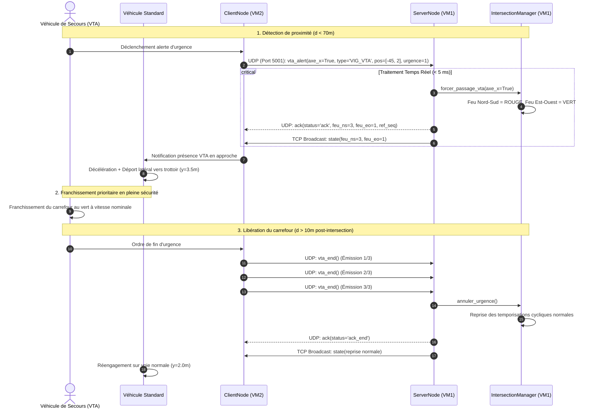

# Spécification et Justification du Protocole V2X / V2I
## Système de Priorité d'Urgence aux Carrefours Urbains — Projet Esk-2718
### SAÉ 3.02 — BUT Réseaux & Télécommunications

---

| Référence Documentaire | Version | Date | Auteur | Classification |
|:---|:---:|:---:|:---:|:---:|
| **DOC-PROTO-V2X-01** | **2.0 — Finale** | Octobre 2026 | Julian Golde / Esk-2718 | Spécification Protocolaire Officielle |

---

## 1. Définition et Mise en Contexte du V2X et du V2I

Dans le domaine des **Systèmes de Transport Intelligents** (ITS — *Intelligent Transportation Systems*), les communications coopératives constituent le levier technologique majeur pour transformer les infrastructures routières passives en réseaux communicants interactifs.

### 1.1 Qu'est-ce que le V2X (Vehicle-to-Everything) ?
Le terme **V2X** regroupe l'ensemble des technologies de communication sans fil permettant à un véhicule d'échanger des informations avec tous les acteurs et objets connectés de son environnement :
- **V2V (Vehicle-to-Vehicle)** : Échange direct entre véhicules proches (télémétrie, vitesse, avertissement de freinage d'urgence).
- **V2I (Vehicle-to-Infrastructure)** : Échange bidirectionnel entre le véhicule et l'infrastructure routière (feux tricolores, capteurs de chaussée, panneaux à messages variables).
- **V2P (Vehicle-to-Pedestrian)** : Interaction avec les usagers vulnérables de la route (piétons, cyclistes équipés d'appareils connectés).
- **V2N (Vehicle-to-Network)** : Connexion à un centre de gestion de trafic via des réseaux cellulaires ou métropolitains.

### 1.2 Le Rôle Stratégique du V2I dans le Projet Esk-2718
Au sein du projet **Esk-2718**, l'axe prioritaire de développement est le **V2I**. Il s'agit d'établir une liaison de communication temps réel entre les véhicules circulant sur les voies d'approche et le régulateur électronique d'intersection (le carrefour à feux).

### 1.3 La Problématique des Véhicules de Secours en Milieu Urbain Dense
Les véhicules d'urgence (pompiers, SAMU/SMUR, police), désignés sous les dénominations réglementaires **VTA** (*Véhicule Toutes Alertes*) et **VTI** (*Véhicule Tout Intérieur*), sont confrontés à des freins majeurs lors de leurs interventions critiques :
1. **La perte de temps aux carrefours à feux** : L'obligation d'aborder une intersection au feu rouge impose un ralentissement drastique voire un arrêt complet, dégradant le délai d'intervention (compromettant l'impératif médical de la *Golden Hour*).
2. **Le risque aigu de collision latérale ("T-Bone")** : Le franchissement au rouge d'un véhicule prioritaire, même avec avertisseurs spéciaux (gyrophares et deux-tons), surprend les conducteurs engagés sur l'axe perpendiculaire au feu vert, générant des collisions à cinétique élevée.
3. **L'encombrement physique des voies** : Les véhicules de secours se retrouvent fréquemment bloqués derrière une file de véhicules arrêtés au feu rouge, incapables de dégager la chaussée faute d'espace suffisant.

**Objectif du système Esk-2718** : Créer une « onde verte dynamique » automatisée qui détecte l'approche du VTA en amont, purge l'intersection en forçant le feu au vert sur son axe, verrouille les axes sécants au rouge, et informe les véhicules situés en amont afin qu'ils se déportent sur le bas-côté.

---

## 2. Cas d'Usage Implémenté : Franchissement Prioritaire de Carrefour par un VTA

### 2.1 Déroulement Chronologique Nominal de l'Intervention

Le cycle de franchissement prioritaire se déroule selon 5 phases séquentielles strictes :

```
[Phase 1 : Approche]           [Phase 2 : Alerte V2I]          [Phase 3 : Arbitrage]
VTA approche à 50 km/h   ===>  Distance < 70 m du centre ===>  Émission UDP vta_alert
                                                               Régulateur force VERT
                                                                        │
                                                                        ▼
[Phase 5 : Rétablissement]     [Phase 4 : Franchissement]      [Dégagement Usagers]
Fin urgence UDP vta_end  <===  VTA traverse le carrefour <===  Véhicules standards
Reprise cycle nominal          Accélère en sécurité            s'arrêtent sur bord
```

1. **Détection d'approche (Zone d'engagement : $R \le 70\,\text{m}$)** :
   Le moteur cinématique du VTA calcule en continu sa distance euclidienne relative au centre du carrefour :
   $$d_{\text{carrefour}} = \sqrt{x^2 + y^2}$$
   Dès que $d_{\text{carrefour}} < 70.0\,\text{m}$, le sous-système V2X du véhicule s'arme et initie la communication prioritaire.

2. **Émission de l'Alerte V2I (`vta_alert`)** :
   Le véhicule émet un datagramme UDP vers l'adresse IP et le port UDP du régulateur d'intersection (Port `5001`). Le message contient l'axe d'approche (`axe_x=true` pour Est-Ouest, `false` pour Nord-Sud), la position cartésienne exacte, le type de véhicule (`VIG_VTA`) et l'indice d'urgence.

3. **Arbitrage Immédiat par l'Infrastructure (Régulateur de Feux)** :
   - À la réception du paquet UDP, le serveur interrompt immédiatement le cycle de feux ordinaire.
   - Si l'axe du VTA était au rouge, il bascule immédiatement au **VERT**.
   - L'axe transversal opposé est immédiatement verrouillé au **ROUGE**, interdisant tout nouvel engagement de véhicules sur la trajectoire de secours.
   - Le serveur renvoie sans délai un acquittement UDP `ack` au véhicule et diffuse par TCP un message d'état `state` à l'ensemble du réseau.

4. **Comportement Coopératif des Usagers Non-Prioritaires** :
   Les véhicules standards qui précèdent le VTA sur la même voie détectent sa présence en approche arrière ($d < 80\,\text{m}$). Conformément au code de la route :
   - Ils activent un freinage modéré ou d'urgence ($a = -5.0\,\text{m/s}^2$).
   - Ils appliquent un déport latéral automatique vers le bord extérieur de la chaussée (voie cible modifiée à $3.5\,\text{m}$ au lieu de $2.0\,\text{m}$), dégageant un couloir de circulation axial libre.

5. **Franchissement et Notification de Fin d'Urgence (`vta_end`)** :
   Dès que le VTA a franchi le centre de l'intersection et s'éloigne au-delà du carrefour ($d > 10\,\text{m}$ sur l'axe de fuite), le véhicule émet un ordre UDP `vta_end`. Pour pallier tout risque de perte de paquet UDP, cet ordre est émis en **triple exemplaire successif**.
   Le régulateur accuse réception (`ack_end`) et restaure les temporisations nominales du carrefour.

---

### 2.2 Diagramme de Séquence Détaillé (UML)



---

## 3. Justification Approfondie des Choix Protocolaires

Le choix de dissocier les canaux de transport entre **TCP** et **UDP** découle d'une analyse technique rigoureuse des caractéristiques intrinsèques des couches de transport réseau :

| Critère d'Évaluation | TCP (Transmission Control Protocol) | UDP (User Datagram Protocol) |
|:---|:---|:---|
| **Mode de connexion** | Orienté connexion (Three-Way Handshake SYN, SYN-ACK, ACK). | Sans connexion (aucun état préalable requis). |
| **Garantie de livraison** | Oui : accusés de réception, réémissions automatiques en cas de perte. | Non : acheminement en "Best-Effort" sans garantie native. |
| **Ordonnancement** | Garanti par numéros de séquence et buffer de réordonnancement. | Aucun : paquets reçus potentiellement dans le désordre. |
| **Latence d'acheminement** | Modérée à forte (pénalisée par le Head-of-Line Blocking et le Nagle). | **Minimale et déterministe** (idéale pour le temps réel critique). |
| **Contrôle de congestion** | Oui (Slow Start, Congestion Avoidance, réduction de fenêtre). | Non : transmission immédiate à plein débit. |
| **Surcharge protocolaire** | En-tête de 20 à 60 octets + paquets ACK retour réguliers. | En-tête minimal de 8 octets. |

### 3.1 Pourquoi TCP pour la Télémétrie et la Synchronisation ?
1. **Intégrité absolue des métriques statistiques** : Les données de simulation (débit horaire, temps moyen d'attente, vitesse moyenne de la flotte) alimentent la base de données SQLite pour l'aide à la décision municipale. La perte silencieuse de points de mesure fausserait les séries temporelles et les analyses scientifiques.
2. **Synchronisation d'état cohérente** : La diffusion de l'état des feux et des scénarios exige qu'aucun client ne diverge de l'état officiel de l'intersection. TCP offre un canal fiable garantissant que chaque mise à jour est reçue dans l'ordre chronologique exact.
3. **Maintien de session persistante** : La connexion TCP permet au serveur de savoir en temps réel quels clients sont connectés, actifs ou défaillants (détection immédiate des clôtures de socket).

### 3.2 Pourquoi UDP pour les Alertes d'Urgence VTA ?
1. **Priorité absolue à la latence minimale** :
   À une vitesse d'approche urbaine de $50\,\text{km/h}$ ($13.88\,\text{m/s}$), un véhicule parcourt environ $1.4\,\text{m}$ tous les $100\,\text{ms}$. Dans une situation d'urgence, chaque milliseconde compte pour garantir que les feux basculent avant que le véhicule n'atteigne le carrefour. Avec UDP, le datagramme est injecté instantanément sur le réseau sans nécessiter l'ouverture préalable d'une session TCP.
2. **Absence d'effet de blocage en tête de file (Head-of-Line Blocking)** :
   Si un paquet TCP est temporairement perdu ou corrompu sur une liaison instable, TCP suspend la remise de tous les paquets ultérieurs jusqu'à ce que la retransmission aboutisse. Pour une alerte d'urgence, **une information retardée est inutile voire dangereuse** : l'infrastructure a besoin de la position actuelle du véhicule, et non d'une position obsolète retransmise avec 500 ms de retard.
3. **Découplage de charge** : Même si le lien TCP de télémétrie est momentanément saturé par le transfert d'un rapport ou d'un scénario volumineux, le canal UDP reste totalement fluide et non impacté.

---

## 4. Mécanismes de Robustesse et Résilience Implémentés

Pour compenser l'absence native de fiabilité d'UDP sans perdre son bénéfice de latence, le protocole **Esk-2718** intègre des gardes-fous applicatifs de niveau transport :

### 4.1 Émission Périodique en Rafale (Heartbeat d'Urgence)
Tant que le véhicule d'urgence est présent dans le périmètre d'action du carrefour ($< 70\,\text{m}$), le nœud client `ClientNode` réémet son alerte UDP toutes les **200 millisecondes**. Si un datagramme isolé venait à être perdu par congestion réseau, le paquet suivant rétablit l'information dans un délai inférieur au temps de réaction humain ($< 0.2\,\text{s}$).

### 4.2 Acquittement Applicatif Bidirectionnel (`ack`)
Bien qu'UDP ne dispose pas d'ACK au niveau transport, notre couche applicative intègre une trame de réponse structurée :
```json
{
    "type": "ack",
    "seq": 45,
    "timestamp": 1729375430.135,
    "payload": {
        "status": "ack",
        "feu_ns": 3,
        "feu_eo": 1,
        "ref_seq": 8
    }
}
```
Ce paquet permet au véhicule de vérifier que l'infrastructure a bien compris sa requête et que le feu lui accorde effectivement la priorité.

### 4.3 Triple Émission Redondante de Clôture d'Urgence (`vta_end`)
Lorsqu'un VTA quitte le carrefour, il n'émet plus de signal d'approche. Pour garantir que l'ordre de fin d'urgence arrive sans faille au serveur (évitant que le carrefour ne reste bloqué au vert indéfiniment), la méthode `send_vta_end()` injecte systématiquement **3 trames successives** dans la file d'émission UDP.

### 4.4 Tolérance aux Pannes et Reconnexion Automatique TCP
Si le lien réseau entre VM 1 et VM 2 subit une coupure matérielle ou un redémarrage du serveur :
- Le client intercepte les exceptions `ConnectionRefusedError`, `BrokenPipeError` et `ConnectionResetError`.
- Il active une procédure de reconnexion automatique avec **backoff exponentiel** ($1\,\text{s}, 2\,\text{s}, 4\,\text{s}, 8\,\text{s}, 16\,\text{s}$) évitant de saturer le réseau.
- Pendant la coupure, les métriques sont conservées dans une file locale bornée (`msg_queue`) et transmises dès le rétablissement de la liaison.

---
*Fin du document de spécification protocolaire V2X/V2I Esk-2718.*
